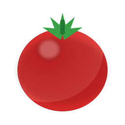
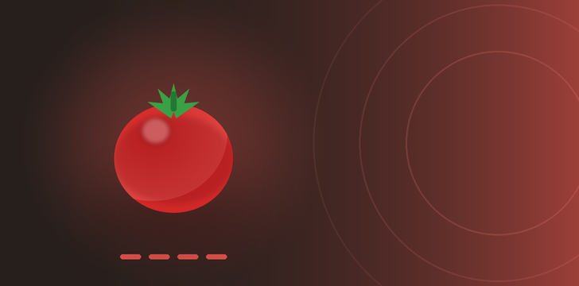

<div align="center">



# 🍅 TomatoFocus 番茄专注

**不只看时间，还看你到底专不专注的番茄钟**

用全局键鼠钩子量化每段番茄里的 **输出 / 一般 / 阅读** 三种专注度，
按「同任务历史基线」给每段打分，并留下可直接建模的原始事件日志。

Windows 10/11 · Electron · TypeScript · 100% 本地运行

[](#-运行要求)
[](https://www.electronjs.org/)
[](https://www.typescriptlang.org/)
[](#-项目状态)
[](#-数据与隐私)

中文 · [English](#english)

</div>



---

## 为什么做这个

普通番茄钟只负责数 25 分钟，结束时给你一声「叮」。
但同样是 25 分钟，写代码、读文档、开着窗口发呆，对番茄钟来说毫无区别。

TomatoFocus 在番茄钟之上加了一层**行为测量**：通过 Windows 低级键盘/鼠标钩子，
统计每段专注里不同类型的键鼠动作，再用**你自己的历史基线**换算成分数。
它不评判你「敲得多就是认真」，而是问：**这段相比你平时做这类任务，是更专注了还是散了？**

三个设计原则：

1. **基线来自你自己** —— 不预设 100 分标准，只和同任务的历史状态比。
2. **数据不出本机** —— 无账号、无网络请求、无遥测，日志存在 `%APPDATA%`。
3. **可分析** —— 原始事件带毫秒时间戳与番茄段 ID，可导出后用 pandas / Python 自己做研究。

## 特性速览

| | 功能 | 说明 |
|---|---|---|
| 🍅 | 番茄状态机 | 专注 25 / 短休 5 / 长休 15（每 4 段），时长可配置；休眠唤醒自动补偿计时 |
| 🎯 | 三条专注度 | 输出（空格）· 一般（Enter + 鼠标左键）· 阅读（滚轮），各自独立基线 |
| 📊 | 基线模型 | 同任务历史速率中位数 ± 3 段平滑；支持手动勾选「我觉得状态不错」的样本当基线 |
| 📈 | 趋势视图 | 自绘 Canvas 曲线，整天模式同屏三条指标线，时间轴 0:00–24:00、5 分钟一格 |
| 🔔 | 段结束提醒 | 系统 Toast（Hero 大图）/ 应用内大弹窗 / 浏览器大字页，三渠道独立开关，一键测试 |
| 🪟 | 桌面常驻 | 托盘图标、最小化到托盘、开机自启、单实例锁 |
| 📝 | 原始事件日志 | 键鼠事件带毫秒时间戳 + 阶段 + 段 ID，按天写 JSONL，pandas 直接读 |
| 🛡️ | 钩子自愈 | 看门狗 5s 巡检 + 10s 心跳；全屏远程桌面抢钩子时自动重装排到链头 |

## 三条专注度怎么算

### 指标定义

| 指标 | 采集来源 | 适用于 |
|---|---|---|
| **输出专注度** | 空格键（`Space`）keydown 次数 | 写代码、写文档这类高频空格的输出型任务 |
| **一般专注度** | `Enter` + **鼠标左键** 点击，合并计数 | 通用型任务，替代早期版本的纯 Enter 分 |
| **阅读专注度** | 滚轮事件次数（上下都算 1 次） | 读文档、刷代码、翻网页 |

### 基线：来自你自己的历史

对每个「任务类型 × 指标」独立维护一条基线，取候选段的**速率中位数**：

- 候选段 = 同任务类型、`focus` 类型、该指标计数 > 0、时长 ≥ 60 秒、非「放弃」段；窗口为**最近 20 段**
- 平滑：把候选段速率排序后，取**中位数及其前后各最多 3 段（最多 7 个值）求平均**；不足 3 段时直接用中位数
- 手动优先：在「基线样本」卡片里勾选任意几段（可不限任务），勾选段的速率中位数**优先于**自动基线，可一键恢复自动

### 评分

```
score = max(0, round(80 × 本段该指标速率 ÷ 该指标基线速率))     速率 = 计数 / 分钟
```

- 达到历史基线 = **80 分**；不设 100 分上限（基线 2 倍速率 = 160 分），鼓励真的突破
- 该任务该指标的**首段**（尚无基线）：只要有计数即记 **80 分建档**；计数为 0 记「无数据」
- 不足 1 分钟的段按 1 分钟折算，避免短段速率虚高
- 每段在结束时**冻结**当时的基线速率，之后改基线不会篡改历史结论（趋势图展示时按当前基线重算）

| 分数 | 含义 |
|---|---|
| ≥ 90 | 超级认真 |
| 75 – 89 | 状态稳定（≈ 你的基线水平） |
| < 75 | 相比平时有所下降 |

## 使用流程

1. **输入本段任务类型**（如「写代码」「写文档」）—— 一段只做一种类型，专注进行中不可改，基线按类型分算。
2. 点「开始专注」。计时环上方实时显示 5 个计数与三条分数的预览。
3. 段结束（到时 / 提前完成 / 跳过）后：
   - **到时** → 分数入档，自动进入休息；**休息结束后不会自动开始下一段**，需要手动点「开始专注」。
   - **提前完成** → 计入基线，随后固定 3 分钟休息，让你喘口气再继续。
   - **跳过 / 放弃** → 不入基线。
4. 到「专注趋势」看当天/历史曲线；觉得自动基线偏了，就去「基线样本」手动勾几条状态好的段。

## 安装与运行

### 运行要求

- **Windows 10 / 11**（仅支持 Windows：依赖 `WH_KEYBOARD_LL` 低级钩子）
- Node.js ≥ 18（仅从源码运行时需要）
- 无需管理员权限

### 从源码运行（当前推荐）

```bash
git clone https://github.com/<your-name>/tomato-focus.git
cd tomato-focus
npm install
npm start          # 构建 + 启动（专注 25 / 短休 5 / 长休 15）
```

> 国内网络建议先设置 Electron 镜像再 `npm install`：
> `set ELECTRON_MIRROR=https://npmmirror.com/mirrors/electron/`（cmd）
> `$env:ELECTRON_MIRROR='https://npmmirror.com/mirrors/electron/'`（PowerShell）

**测试模式**（每段 1 分钟，方便快速验证全链路）：

```bash
npm run start:test
```

**提醒渠道预览**（不用等到点，直接看三种提醒长什么样）：

```bash
npm start -- --remind-demo                 # 按设置里的开关走
npm start -- --remind-demo=system,popup    # 只演示指定渠道
```

### 打包 Windows 安装包

```bash
npm run dist       # 输出 NSIS 安装包到 release/
```

## 数据与隐私

所有数据都留在你自己的机器上：

| 路径 | 内容 |
|---|---|
| `%APPDATA%\tomato-focus\config.json` | 配置 + 全部番茄段归档（含分数与基线快照） |
| `%APPDATA%\tomato-focus\events\YYYY-MM-DD.jsonl` | 原始键鼠事件日志，每行一条 JSON，按天分文件 |
| `%APPDATA%\tomato-focus\logs\remind.log` | 提醒渠道分发记录（排查「没弹」还是「被系统吃掉」） |

**明确不做的事：**

- ❌ 不记录按键对应的**字符内容**，只记键名（`Enter`、`A`…）与键码
- ❌ 不记录鼠标移动轨迹，只记点击按钮与滚轮方向
- ❌ 不联网，没有任何上传、账号或遥测代码

⚠️ **但请注意**：键码序列在理论上可被推断出打字内容，`events/*.jsonl` 请当作私人数据对待，**不要随意外传**。

### 杀软 / EDR 提示

全局键盘钩子（`WH_KEYBOARD_LL`）是键盘记录器的常用技术，因此本程序有可能被杀软或 EDR 告警。
这是技术手段撞车，不是行为恶意 —— 代码全部开源，欢迎自行审计。如被拦截：
把安装目录加入白名单；若要对外分发，建议做代码签名。

## 全局钩子与远程桌面

- 统计的是**本机物理键盘**，与前台窗口无关。用 ToDesk / 向日葵 / mstsc 远程办公时，
  本地敲的键盘依然会先经过本机钩子 → 计数不会断。
- **mstsc 全屏问题**：远程桌面全屏时会安装自己的低级钩子，且「后装先调用」并不向下传递，
  导致我们的钩子收不到按键。TomatoFocus 会监视前台全屏窗口变化，检测到新全屏窗口时**自动重装钩子**，让自己排回链头。
  也可以在 mstsc 的「本地资源 → 键盘」中把 Windows 键组合改为「在这台计算机上」。

## 项目结构

```
src/main/main.ts       主进程：窗口 / 托盘 / 开机自启 / 提醒分发（系统通知·大弹窗·网页）/ IPC
src/main/pomodoro.ts   番茄状态机：计时、漂移修正、分段归档、提前完成与放弃
src/main/hook.ts       全局键鼠钩子：五项计数、看门狗自愈、事件转发
src/main/eventlog.ts   原始事件日志（JSONL，按天分文件）
src/main/focus.ts      专注度算法：三指标定义、基线、评分、历史重算
src/main/fgwatch.ts    前台全屏窗口监视（koffi 调 user32，修复远程桌面抢钩子）
src/main/store.ts      electron-store 封装（配置 + 段归档 + 旧记录兼容）
src/preload/preload.ts contextBridge 安全桥
src/renderer/          界面：计时环 / 实时计数 / 历史曲线 / 提醒大弹窗
assets/                Toast Hero 大图、浏览器提醒页模板
scripts/               渲染层拷贝、图标与 Hero 图生成脚本
```

## 技术栈

- **Electron 37** + **TypeScript 5**（主进程严格模式）
- [`uiohook-napi`](https://github.com/SnosMe/uiohook-napi) —— libuiohook 的 Node 绑定，全局键鼠钩子
- [`electron-store`](https://github.com/sindresorhus/electron-store) —— JSON 落盘
- [`koffi`](https://koffi.dev/) —— 调用 `user32.dll` 做全屏前台窗口检测
- 渲染层**零框架零图表库**：原生 DOM + Canvas 自绘曲线

## 开发

```bash
npm install
npm run build        # tsc 编译主进程 + 拷贝渲染层资源到 dist/
npm run typecheck    # 仅类型检查
npm start            # 构建并启动
npm run dist         # 打包 NSIS 安装包
```

调试点：

- 主进程日志直接打在终端；渲染层用 `Ctrl+Shift+I` 开 DevTools。
- 钩子状态、当前段 ID、userData 路径会在启动日志里打印。
- 段数据被误清空时，可从 `events/*.jsonl` 按段 ID 重建归档（见 `scripts/recover-sessions.mjs`）。

## 已知限制与 Roadmap

- [x] 三指标专注度 + 同任务基线
- [x] 手动基线样本 / 趋势视图 / 三渠道提醒 / 引导说明
- [ ] 安装包 Release（下一步）
- [ ] 一周 / 一月维度的基线稳定性报告
- [ ] 事件日志的 Python 分析示例（分心检测、打字节奏）
- [ ] 多显示器 / 主题适配细化
- [ ] 非 Windows 平台（macOS/Linux 钩子与通知差异较大，暂不承诺）

## 项目状态

当前为 **private preview**：作者自己在用，接口与数据结构仍可能调整。
欢迎通过 Issue 提建议，正式公开后会补上 LICENSE 与完整截图。

## 许可

暂未指定开源协议。在补充 `LICENSE` 之前，请勿直接复制、分发或用于商业项目；
如需使用请先开 Issue 联系作者。

---

<h1 id="english">English</h1>

**TomatoFocus** is a Windows-only Pomodoro timer that measures how focused you actually were,
not just how much time passed.

While a focus session runs, a low-level keyboard/mouse hook (`uiohook-napi`) counts four kinds of
behavior and turns them into three independent focus scores:

| Score | Signal |
|---|---|
| **Output** | `Space` keydowns — writing code/docs |
| **General** | `Enter` + left mouse clicks — generic work |
| **Reading** | Wheel scroll events — reading docs/code |

Each metric has its **own baseline derived from your own history** for the same task type
(median rate of qualifying sessions, smoothed over the median ± 3 neighbouring sessions):

```
score = max(0, round(80 × thisSessionRate ÷ yourBaselineRate))
```

Reaching your usual pace scores 80, and there is no 100 cap — beating your baseline by 2× gives 160.
The first session for a task/metric is recorded as 80 to establish the baseline.
Sessions shorter than one minute are normalized to a 1-minute rate.

Other features: pomodoro state machine with drift/hibernate correction, tray + autostart,
end-of-session reminders over three independently toggleable channels (Windows toast with a hero image,
in-app modal, or a big-type browser page), a self-healing hook watchdog, an automatic re-hook when a
fullscreen remote-desktop window steals the hook chain, and a raw event log
(`%APPDATA%\tomato-focus\events\YYYY-MM-DD.jsonl`, one JSON per line, tagged with phase and session id)
ready for pandas.

**Privacy:** everything stays local. No key *characters* are recorded (only key names/codes),
no mouse movement, no network access, no accounts, no telemetry. Note that key-code sequences can
theoretically reveal typed text, so treat `events/*.jsonl` as private data.

**Run it:**

```bash
git clone https://github.com/<your-name>/tomato-focus.git
cd tomato-focus
npm install
npm start            # normal mode: 25 / 5 / 15
npm run start:test   # 1-minute sessions, for end-to-end checks
npm run dist         # build an NSIS installer into release/
```

Requires Windows 10/11 and Node.js ≥ 18. No admin rights needed.
Low-level keyboard hooks are sometimes flagged by antivirus software — that is a false positive
based on technique, not behavior; the source is here for you to audit.

Status: **private preview**, data shapes may still change. License: TBD (please open an issue first).

<div align="center"><sub>Built for people who want to know whether 25 minutes was really 25 minutes.</sub></div>
