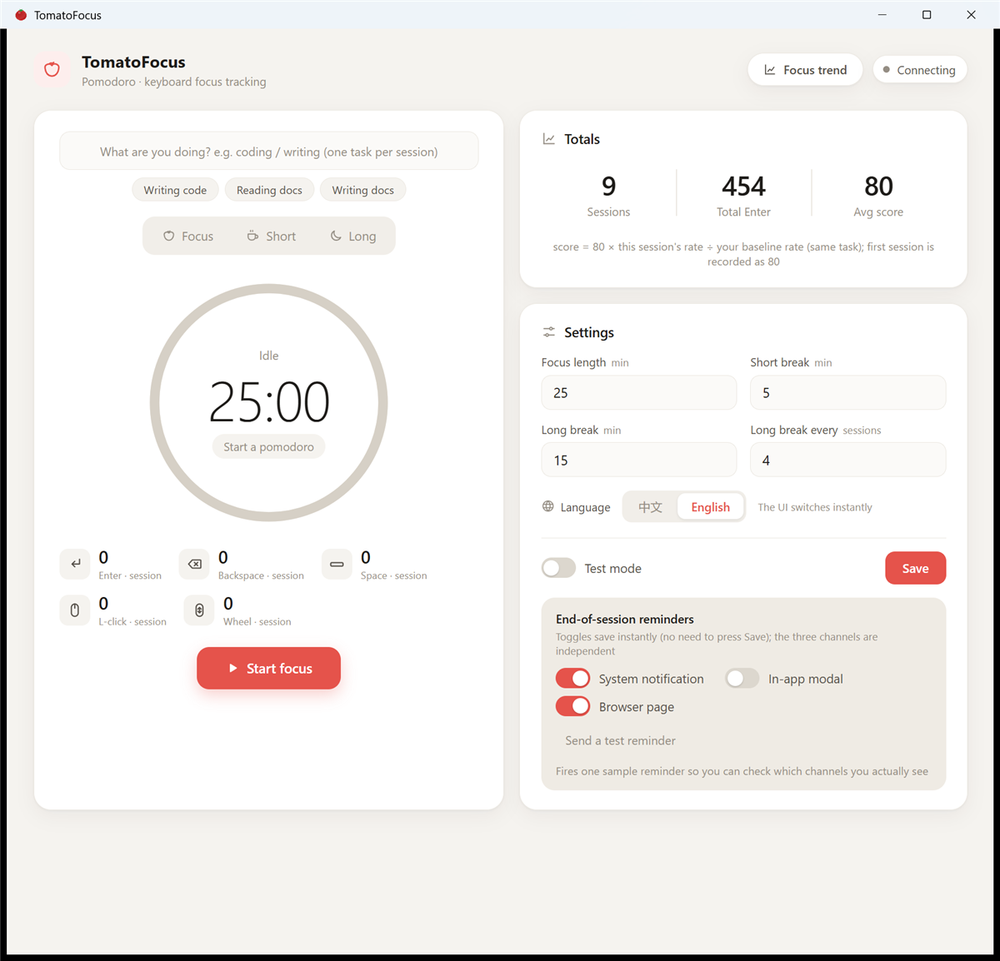
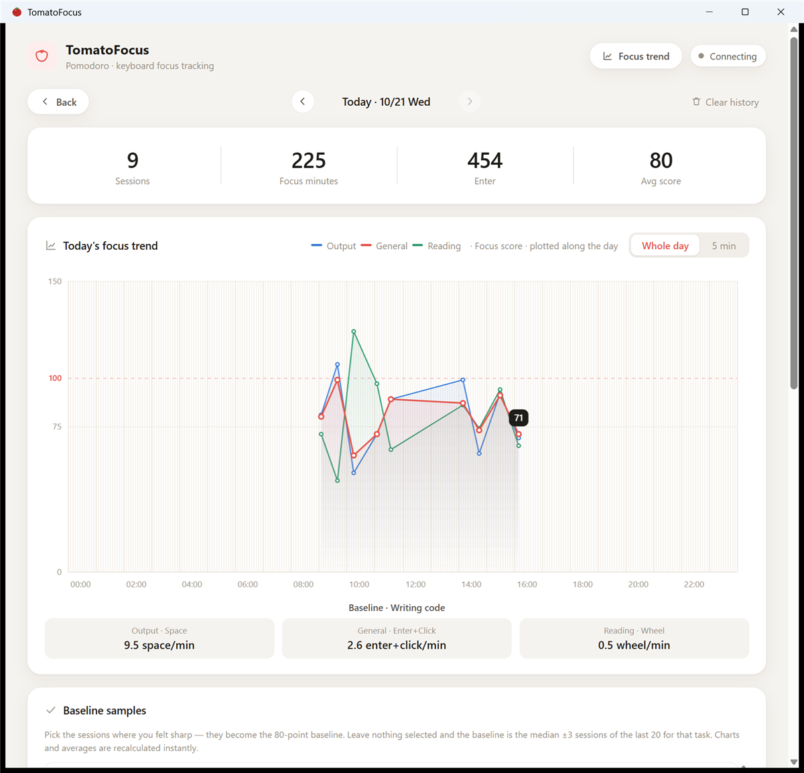
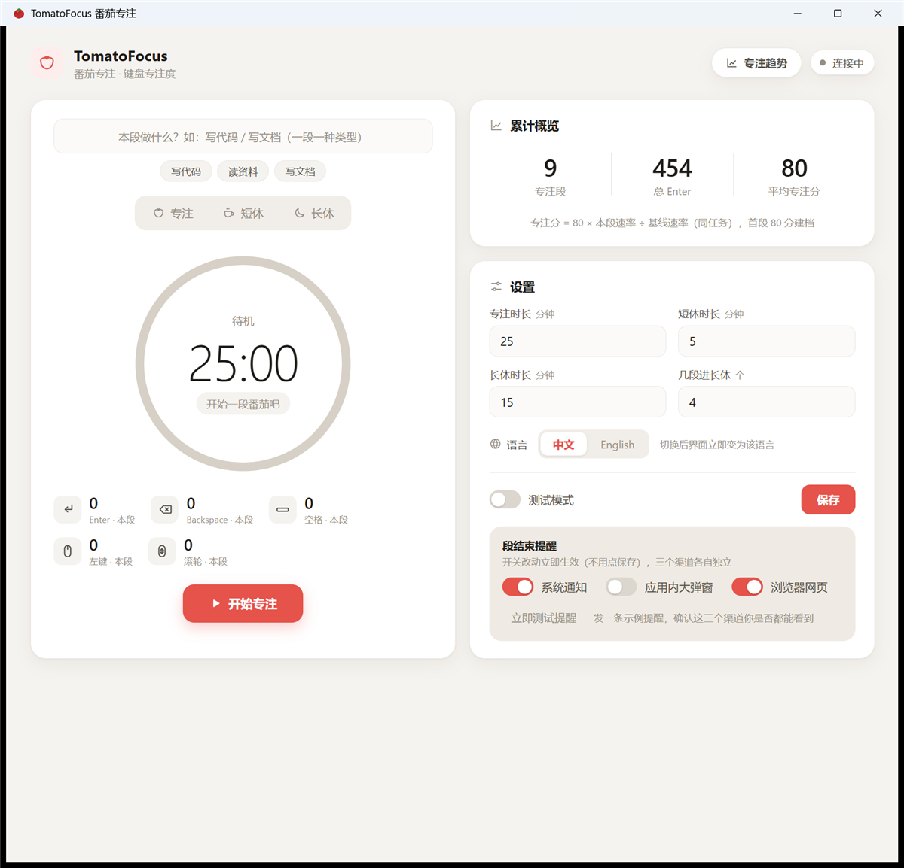
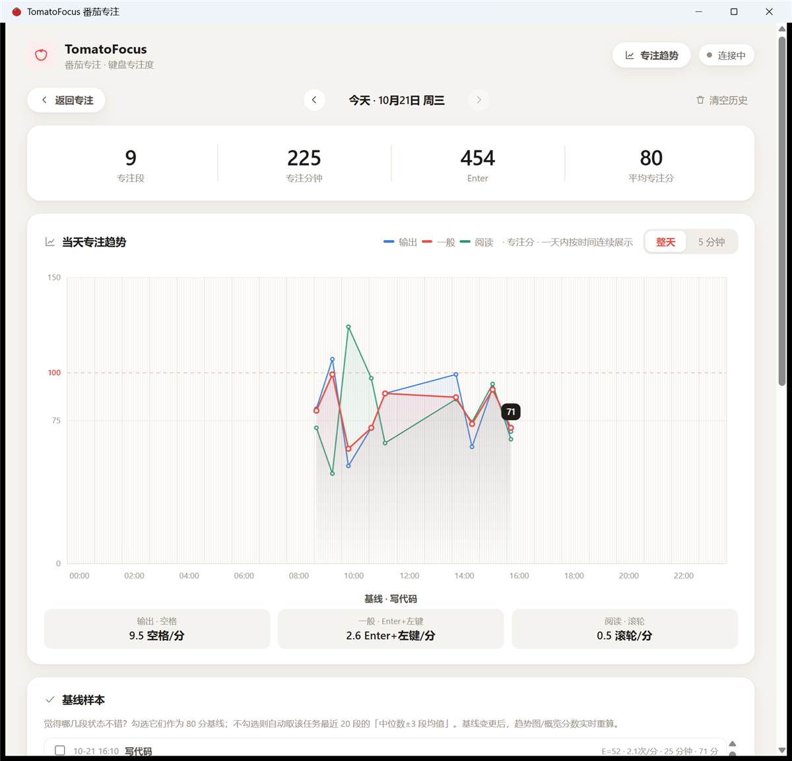

<div align="center">


# 🍅 TomatoFocus

**A pomodoro timer that doesn't just count minutes — it measures whether you were actually focused.**

Quantifies three kinds of focus per session (Output / General / Reading) from global keyboard and
mouse activity, scores every session against **your own per-task baseline**, and keeps a raw event
log you can analyse yourself.

Windows 10/11 · Electron · TypeScript · runs entirely offline · UI in English & 中文

[](#requirements)
[](https://www.electronjs.org/)
[](https://www.typescriptlang.org/)
[](https://github.com/XiaoSaT/tomato-focus/releases/latest)
[](https://github.com/XiaoSaT/tomato-focus/releases)
[](LICENSE)

[English](#english) · [中文](#中文)

</div>

> **A word from the author**
>
> Hi everyone, I'm the author of TomatoFocus. There are plenty of pomodoro apps out there and I've
> tried a few of them, but what I really care about is working efficiently — so I built this focus
> metric based on keyboard and mouse activity. After using it for a while, I found my attention
> fluctuating in genuinely interesting ways from day to day. Give it a try and see what yours looks like.
>
> **作者的话**
>
> 大家好，我是番茄专注的作者。市面上其实有很多番茄时间的软件，我也体验了一些，但想了想，
> 我主体上还是想要高效工作，所以就做了这个基于键盘和鼠标的专注指标。用了一段时间之后，
> 我发现了我每天注意力有趣的波动。大家都来试一试吧。

---

## English

### Screenshots

| Timer & settings | Focus trend |
|---|---|
|  |  |

*(Screenshots use synthetic demo data. The same windows in Chinese are [further down](#中文).)*

### Why this exists

A normal pomodoro timer counts 25 minutes and rings. But 25 minutes of writing code, 25 minutes of
reading docs, and 25 minutes of staring at a window look identical to it.

TomatoFocus adds a layer of **behavioural measurement** on top of the timer: a Windows low-level
keyboard/mouse hook counts different kinds of input during each session, and those counts are
converted into a score using **your own historical baseline for that task**. It never claims
"more keys = more focus" — it asks: *compared to how you usually perform on this kind of task, was
this session sharper or more scattered?*

Three design principles:

1. **The baseline is you.** There is no universal 100-point standard; you are only compared with your own same-task history.
2. **Data never leaves the machine.** No account, no network calls, no telemetry; everything lives in `%APPDATA%`.
3. **Analysable.** Raw events carry millisecond timestamps and session ids, so you can export them and do your own research with pandas.

### Features

| | Feature | Detail |
|---|---|---|
| 🍅 | Pomodoro state machine | Focus 25 / short break 5 / long break 15 (every 4th), all configurable; wall-clock correction after sleep/hibernate |
| 🎯 | Three focus metrics | Output (Space) · General (Enter + left click) · Reading (wheel) — each with its own baseline |
| 📊 | Baseline model | Median of your same-task history, smoothed over median ±3 sessions; you can also hand-pick "I felt sharp" sessions |
| 📈 | Trend view | Hand-drawn Canvas charts, a whole-day mode with all three metric lines (00:00–24:00, 5-min grid) |
| 🔔 | End-of-session reminders | Windows toast (hero image) / in-app modal / big-type browser page — three independent channels, one-click test |
| 🪟 | Lives in the tray | Tray icon, minimise-to-tray, run at login, single-instance lock |
| 📝 | Raw event log | Key/mouse events with ms timestamps + phase + session id, written as JSONL per day, readable by pandas |
| 🛡️ | Self-healing hook | 5 s watchdog + 10 s heartbeat; automatically re-hooks to the head of the chain when a fullscreen remote-desktop window steals it |
| 🌐 | Bilingual UI | English / 中文 switchable inside the app (Settings → Language), no restart needed |

### The three focus metrics

| Metric | Captured from | Suits |
|---|---|---|
| **Output** | `Space` keydowns | Coding, writing — output-heavy tasks with lots of spaces |
| **General** | `Enter` + **left mouse clicks**, counted together | General work; replaces the Enter-only score of earlier versions |
| **Reading** | Wheel events (either direction counts as 1) | Reading docs, scrolling code, browsing |

### Baseline and scoring

For every *task type × metric* pair, an independent baseline is maintained from the **median rate** of
qualifying sessions:

- Qualifying = same task type, `focus` session, that metric's count > 0, duration ≥ 60 s, not abandoned; window = **last 20 sessions**
- Smoothing: sort the qualifying rates and average **the median plus up to 3 neighbours on each side (≤ 7 values)**; with fewer than 3 sessions, the plain median is used
- Manual override: pick any sessions in the *Baseline samples* card and their median rate takes precedence over the automatic baseline (one click restores automatic)

```
score = max(0, round(80 × this session's rate ÷ the metric's baseline rate))     rate = count / minute
```

- Hitting your historical baseline = **80 points**; there is no 100 cap (2× the baseline rate = 160), so real improvement is visible
- The **first** session for a task/metric (no baseline yet) scores **80** as long as it has any count; a zero count is shown as "no data"
- Sessions shorter than a minute are normalised to a one-minute rate, so short sessions can't inflate their rate
- Each session freezes the baseline rate it was scored with; changing the baseline does not rewrite history (charts are re-scored live for display)

| Score | Meaning |
|---|---|
| ≥ 90 | Super focused |
| 75 – 89 | Steady (≈ your baseline) |
| < 75 | Slipping compared with your usual pace |

### How to use it

1. **Name the task** for the session (e.g. "Writing code"). One task per session; it is locked while a focus session runs, and baselines are computed per task type.
2. Press **Start focus**. The five counters and a live preview of the three scores update as you type.
3. When the session ends (timer / finish early / skip):
   - **Timer end** → the score is archived and a break starts automatically. **When the break ends nothing starts by itself** — you click *Start focus*.
   - **Finish early** → counted into the baseline, followed by a fixed 3-minute break.
   - **Skip / abandon** → not counted into the baseline.
4. Open **Focus trend** for the day's curves; if the automatic baseline drifts away from reality, hand-pick a few good sessions under *Baseline samples*.

### Install

#### Requirements

- **Windows 10 / 11** (Windows-only: relies on the `WH_KEYBOARD_LL` low-level hook)
- Node.js ≥ 18 (only when running from source)
- No administrator rights needed

#### Download the installer (recommended)

Grab the latest `TomatoFocus-Setup-x.y.z.exe` from [**Releases**](https://github.com/XiaoSaT/tomato-focus/releases/latest)
(NSIS installer, ~92 MB). Double-click, install, done — no Node.js required.

> The installer is not code-signed, so SmartScreen may warn "Windows protected your PC":
> click *More info → Run anyway*. If you would rather not, build it yourself from source.

#### From source

```bash
git clone https://github.com/XiaoSaT/tomato-focus.git
cd tomato-focus
npm install
npm start          # build + launch (25 / 5 / 15)
```

> Behind a slow connection to GitHub, set the Electron mirror before `npm install`:
> `set ELECTRON_MIRROR=https://npmmirror.com/mirrors/electron/` (cmd) or
> `$env:ELECTRON_MIRROR='https://npmmirror.com/mirrors/electron/'` (PowerShell)

**Test mode** (1-minute sessions, for end-to-end checks):

```bash
npm run start:test
```

**Preview the reminder channels** without waiting for a session to end:

```bash
npm start -- --remind-demo                 # follow the switches in Settings
npm start -- --remind-demo=system,popup    # only the listed channels
```

#### Build the Windows installer

```bash
npm run dist       # NSIS installer into release/
```

### Switching the language

**Settings → Language → 中文 / English.** The whole UI (including tray menu, notifications and the
browser reminder page) switches instantly and the choice is remembered. On first launch the app
follows your Windows display language.

### Data and privacy

Everything stays on your machine:

| Path | Contents |
|---|---|
| `%APPDATA%\tomato-focus\config.json` | Settings + all archived sessions (scores and baseline snapshots included) |
| `%APPDATA%\tomato-focus\events\YYYY-MM-DD.jsonl` | Raw key/mouse event log, one JSON per line, one file per day |
| `%APPDATA%\tomato-focus\logs\remind.log` | Which reminder channels fired (to tell "never triggered" from "swallowed by the OS") |

**What it deliberately does not do:**

- ❌ It does **not** record the characters you type — only key names (`Enter`, `A`, …) and key codes
- ❌ It does not record mouse movement — only click buttons and wheel direction
- ❌ It makes no network requests, has no account and no telemetry code

⚠️ **But note:** key-code sequences can theoretically be used to infer typed text, so treat
`events/*.jsonl` as private data and **do not share those files**.

#### Antivirus / EDR warnings

A global keyboard hook (`WH_KEYBOARD_LL`) is the technique keyloggers use, so antivirus or EDR may
flag TomatoFocus. That is a false positive based on technique, not behaviour — the complete source
is right here for you to audit. If it gets blocked, whitelist the install directory; for public
distribution, code signing is recommended.

### Global hooks and remote desktop

- It counts the **local physical keyboard**, independent of which window is focused. When you work
  over ToDesk / Sunflower / mstsc, local keystrokes still pass through the local hook, so counting continues.
- **Fullscreen mstsc problem**: fullscreen remote desktop installs its own low-level hook and, since
  "last installed is called first", it never forwards events — our hook stops seeing keys. TomatoFocus
  watches for a new fullscreen foreground window and **re-installs the hook** so it is back at the head
  of the chain. You can also set mstsc's *Local Resources → Keyboard* to "On this computer".

### Project layout

```
src/main/main.ts       Main process: window / tray / autostart / reminder dispatch (toast, modal, web page) / IPC
src/main/pomodoro.ts   Pomodoro state machine: timing, drift correction, archiving, early finish & skip
src/main/hook.ts       Global key/mouse hook: five counters, watchdog, event forwarding
src/main/eventlog.ts   Raw event log (JSONL, one file per day)
src/main/focus.ts      Focus algorithm: metrics, baselines, scoring, re-scoring history
src/main/fgwatch.ts    Fullscreen foreground watcher (koffi → user32, fixes the RDP hook theft)
src/main/store.ts      electron-store wrapper (settings + sessions + legacy migration)
src/main/i18n.ts       Main-process strings (tray, notifications, reminder page)
src/preload/preload.ts contextBridge safety bridge
src/renderer/          UI: timer ring, live counters, charts, reminder modal
src/renderer/i18n.js   Renderer string dictionary + static DOM translation
assets/                Toast hero images, browser reminder page template
scripts/               Renderer copy step, icon/hero generators
```

### Tech stack

- **Electron 37** + **TypeScript 5** (strict mode in the main process)
- [`uiohook-napi`](https://github.com/SnosMe/uiohook-napi) — Node bindings for libuiohook, the global hook
- [`electron-store`](https://github.com/sindresorhus/electron-store) — JSON persistence
- [`koffi`](https://koffi.dev/) — calls `user32.dll` to detect fullscreen foreground windows
- Renderer: **no framework, no chart library** — plain DOM + hand-rolled Canvas charts

### Development

```bash
npm install
npm run build        # tsc for the main process + copy renderer assets into dist/
npm run typecheck    # types only
npm start            # build & launch
npm run dist         # NSIS installer
```

Debugging notes:

- Main-process logs go straight to the terminal; press **F12** in the window for DevTools (dev builds).
- The startup log prints the hook status, current session id and the userData path.
- Raw events carry `phase` / `seg`; `seg` equals `sessions[].id` in `config.json`, so you can join them directly for your own analysis.

### Roadmap

- [x] Three-metric focus scoring with per-task baselines
- [x] Manual baseline samples / trend view / three reminder channels / onboarding guide
- [x] Installer releases
- [x] English & Chinese UI, switchable in-app
- [ ] Weekly / monthly baseline stability report
- [ ] Python analysis examples for the event log (distraction detection, typing rhythm)
- [ ] Code signing (to silence SmartScreen)
- [ ] Better multi-monitor and theme handling
- [ ] Non-Windows platforms (hooks and notifications differ a lot; not promised)

### License

[MIT License](LICENSE) © 2026 XiaoSaT — free to use, modify, distribute and use commercially; just keep
the copyright and licence notice.

---

## 中文

### 界面截图

| 计时与设置 | 专注趋势 |
|---|---|
|  |  |

*(截图使用合成的演示数据。英文界面见 [上面](#english)。)*

### 为什么做这个

普通番茄钟只负责数 25 分钟，结束时给你一声「叮」。
但同样是 25 分钟，写代码、读文档、开着窗口发呆，对番茄钟来说毫无区别。

TomatoFocus 在番茄钟之上加了一层**行为测量**：通过 Windows 低级键盘/鼠标钩子，统计每段专注里
不同类型的键鼠动作，再用**你自己的历史基线**换算成分数。它不评判「敲得多就是认真」，而是问：
**这段相比你平时做这类任务，是更专注了还是散了？**

三个设计原则：

1. **基线来自你自己** —— 不预设 100 分标准，只和同任务的历史状态比。
2. **数据不出本机** —— 无账号、无网络请求、无遥测，日志存在 `%APPDATA%`。
3. **可分析** —— 原始事件带毫秒时间戳与番茄段 ID，可导出后用 pandas / Python 自己做研究。

### 功能一览

| | 功能 | 说明 |
|---|---|---|
| 🍅 | 番茄状态机 | 专注 25 / 短休 5 / 长休 15（每 4 段），时长可配置；休眠唤醒自动补偿计时 |
| 🎯 | 三条专注度 | 输出（空格）· 一般（Enter + 鼠标左键）· 阅读（滚轮），各自独立基线 |
| 📊 | 基线模型 | 同任务历史速率中位数 ± 3 段平滑；支持手动勾选「我觉得状态不错」的样本当基线 |
| 📈 | 趋势视图 | 自绘 Canvas 曲线，整天模式同屏三条指标线，时间轴 0:00–24:00、5 分钟一格 |
| 🔔 | 段结束提醒 | 系统 Toast（Hero 大图）/ 应用内大弹窗 / 浏览器大字页，三渠道独立开关，一键测试 |
| 🪟 | 桌面常驻 | 托盘图标、最小化到托盘、开机自启、单实例锁 |
| 📝 | 原始事件日志 | 键鼠事件带毫秒时间戳 + 阶段 + 段 ID，按天写 JSONL，pandas 直接读 |
| 🛡️ | 钩子自愈 | 看门狗 5s 巡检 + 10s 心跳；全屏远程桌面抢钩子时自动重装排到链头 |
| 🌐 | 中英双语 | 界面内随时切换中文 / English（设置 → 语言），不用重启 |

### 三条专注度指标

| 指标 | 采集来源 | 适用于 |
|---|---|---|
| **输出专注度** | 空格键（`Space`）keydown 次数 | 写代码、写文档这类高频空格的输出型任务 |
| **一般专注度** | `Enter` + **鼠标左键** 点击，合并计数 | 通用型任务，替代早期版本的纯 Enter 分 |
| **阅读专注度** | 滚轮事件次数（上下都算 1 次） | 读文档、刷代码、翻网页 |

### 基线怎么来

对每个「任务类型 × 指标」独立维护一条基线，取候选段的**速率中位数**：

- 候选段 = 同任务类型、`focus` 类型、该指标计数 > 0、时长 ≥ 60 秒、非「放弃」段；窗口为**最近 20 段**
- 平滑：把候选段速率排序后，取**中位数及其前后各最多 3 段（最多 7 个值）求平均**；不足 3 段时直接用中位数
- 手动优先：在「基线样本」卡片里勾选任意几段（可不限任务），勾选段的速率中位数**优先于**自动基线，可一键恢复自动

### 评分规则

```
score = max(0, round(80 × 本段该指标速率 ÷ 该指标基线速率))     速率 = 计数 / 分钟
```

- 达到历史基线 = **80 分**；不设 100 分上限（基线 2 倍速率 = 160 分），鼓励真的突破
- 该任务该指标的**首段**（尚无基线）：只要有计数即记 **80 分建档**；计数为 0 记「无数据」
- 不足 1 分钟的段按 1 分钟折算，避免短段速率虚高
- 每段在结束时**冻结**当时的基线速率，之后改基线不会篡改历史结论（趋势图展示时按当前基线重算）

| 分数 | 含义 |
|---|---|
| ≥ 90 | 超级认真 |
| 75 – 89 | 状态稳定（≈ 你的基线水平） |
| < 75 | 相比平时有所下降 |

### 使用流程

1. **输入本段任务类型**（如「写代码」「写文档」）—— 一段只做一种类型，专注进行中不可改，基线按类型分算。
2. 点「开始专注」。计时环上方实时显示 5 个计数与三条分数的预览。
3. 段结束（到时 / 提前完成 / 跳过）后：
   - **到时** → 分数入档，自动进入休息；**休息结束后不会自动开始下一段**，需要手动点「开始专注」。
   - **提前完成** → 计入基线，随后固定 3 分钟休息，让你喘口气再继续。
   - **跳过 / 放弃** → 不入基线。
4. 到「专注趋势」看当天/历史曲线；觉得自动基线偏了，就去「基线样本」手动勾几条状态好的段。

### 安装

#### 运行要求

- **Windows 10 / 11**（仅支持 Windows：依赖 `WH_KEYBOARD_LL` 低级钩子）
- Node.js ≥ 18（仅从源码运行时需要）
- 无需管理员权限

#### 下载安装包（推荐）

到 [**Releases**](https://github.com/XiaoSaT/tomato-focus/releases/latest) 下载最新的
`TomatoFocus-Setup-x.y.z.exe`（NSIS 安装包，约 92 MB），双击安装即可，无需管理员权限，也不需要 Node.js。

> 安装包未做代码签名，Windows SmartScreen 可能提示「Windows 已保护你的电脑」，
> 点「更多信息 → 仍要运行」即可；介意的话可以直接从源码构建。

#### 从源码运行

```bash
git clone https://github.com/XiaoSaT/tomato-focus.git
cd tomato-focus
npm install
npm start          # 构建 + 启动（专注 25 / 短休 5 / 长休 15）
```

> 国内网络建议先设置 Electron 镜像再 `npm install`：
> `set ELECTRON_MIRROR=https://npmmirror.com/mirrors/electron/`（cmd）
> `$env:ELECTRON_MIRROR='https://npmmirror.com/mirrors/electron/'`（PowerShell）

**测试模式**（每段 1 分钟，方便快速验证全链路）：

```bash
npm run start:test
```

**提醒渠道预览**（不用等到点，直接看三种提醒长什么样）：

```bash
npm start -- --remind-demo                 # 按设置里的开关走
npm start -- --remind-demo=system,popup    # 只演示指定渠道
```

#### 打包 Windows 安装包

```bash
npm run dist       # 输出 NSIS 安装包到 release/
```

### 中英文切换

**设置 → 语言 → 中文 / English。** 整个界面（含托盘菜单、系统通知、浏览器提醒页）立即切换，
选择会记住；首次启动跟随 Windows 显示语言。

### 数据与隐私

所有数据都留在你自己的机器上：

| 路径 | 内容 |
|---|---|
| `%APPDATA%\tomato-focus\config.json` | 配置 + 全部番茄段归档（含分数与基线快照） |
| `%APPDATA%\tomato-focus\events\YYYY-MM-DD.jsonl` | 原始键鼠事件日志，每行一条 JSON，按天分文件 |
| `%APPDATA%\tomato-focus\logs\remind.log` | 提醒渠道分发记录（排查「没弹」还是「被系统吃掉」） |

**明确不做的事：**

- ❌ 不记录按键对应的**字符内容**，只记键名（`Enter`、`A`…）与键码
- ❌ 不记录鼠标移动轨迹，只记点击按钮与滚轮方向
- ❌ 不联网，没有任何上传、账号或遥测代码

⚠️ **但请注意**：键码序列在理论上可被推断出打字内容，`events/*.jsonl` 请当作私人数据对待，**不要随意外传**。

#### 杀软 / EDR 提示

全局键盘钩子（`WH_KEYBOARD_LL`）是键盘记录器的常用技术，因此本程序有可能被杀软或 EDR 告警。
这是技术手段撞车，不是行为恶意 —— 源码完整可读，欢迎自行审计。如被拦截：把安装目录加入白名单；
若要对外分发，建议做代码签名。

### 全局钩子与远程桌面

- 统计的是**本机物理键盘**，与前台窗口无关。用 ToDesk / 向日葵 / mstsc 远程办公时，
  本地敲的键盘依然会先经过本机钩子 → 计数不会断。
- **mstsc 全屏问题**：远程桌面全屏时会安装自己的低级钩子，且「后装先调用」并不向下传递，
  导致我们的钩子收不到按键。TomatoFocus 会监视前台全屏窗口变化，检测到新全屏窗口时**自动重装钩子**，
  让自己排回链头。也可以在 mstsc 的「本地资源 → 键盘」中把 Windows 键组合改为「在这台计算机上」。

### 项目结构

```
src/main/main.ts       主进程：窗口 / 托盘 / 开机自启 / 提醒分发（系统通知·大弹窗·网页）/ IPC
src/main/pomodoro.ts   番茄状态机：计时、漂移修正、分段归档、提前完成与放弃
src/main/hook.ts       全局键鼠钩子：五项计数、看门狗自愈、事件转发
src/main/eventlog.ts   原始事件日志（JSONL，按天分文件）
src/main/focus.ts      专注度算法：三指标定义、基线、评分、历史重算
src/main/fgwatch.ts    前台全屏窗口监视（koffi 调 user32，修复远程桌面抢钩子）
src/main/store.ts      electron-store 封装（配置 + 段归档 + 旧记录兼容）
src/main/i18n.ts       主进程文案（托盘 / 通知 / 提醒页）
src/preload/preload.ts contextBridge 安全桥
src/renderer/          界面：计时环 / 实时计数 / 历史曲线 / 提醒大弹窗
src/renderer/i18n.js   界面文案词典 + 静态节点翻译
assets/                Toast Hero 大图、浏览器提醒页模板
scripts/               渲染层拷贝、图标与 Hero 图生成脚本
```

### 技术栈

- **Electron 37** + **TypeScript 5**（主进程严格模式）
- [`uiohook-napi`](https://github.com/SnosMe/uiohook-napi) —— libuiohook 的 Node 绑定，全局键鼠钩子
- [`electron-store`](https://github.com/sindresorhus/electron-store) —— JSON 落盘
- [`koffi`](https://koffi.dev/) —— 调用 `user32.dll` 做全屏前台窗口检测
- 渲染层**零框架零图表库**：原生 DOM + Canvas 自绘曲线

### 开发

```bash
npm install
npm run build        # tsc 编译主进程 + 拷贝渲染层资源到 dist/
npm run typecheck    # 仅类型检查
npm start            # 构建并启动
npm run dist         # 打包 NSIS 安装包
```

调试点：

- 主进程日志直接打在终端；开发版窗口里按 **F12** 开 DevTools。
- 钩子状态、当前段 ID、userData 路径会在启动日志里打印。
- 原始事件日志带 `phase` / `seg` 字段，`seg` 与 `config.json` 中 `sessions[].id` 一致，可直接 join 做二次分析。

### 已知限制与 Roadmap

- [x] 三指标专注度 + 同任务基线
- [x] 手动基线样本 / 趋势视图 / 三渠道提醒 / 引导说明
- [x] 安装包 Release
- [x] 中英文界面，应用内切换
- [ ] 一周 / 一月维度的基线稳定性报告
- [ ] 事件日志的 Python 分析示例（分心检测、打字节奏）
- [ ] 代码签名（消除 SmartScreen 警告）
- [ ] 多显示器 / 主题适配细化
- [ ] 非 Windows 平台（macOS/Linux 钩子与通知差异较大，暂不承诺）

### 许可

[MIT License](LICENSE) © 2026 XiaoSaT —— 可自由使用、修改、分发与商用，保留版权与许可声明即可。
